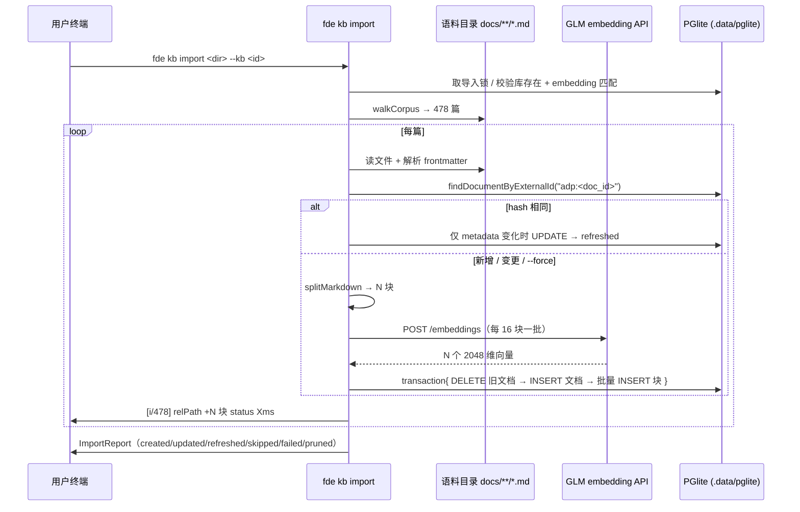

# ADP 文档批量入库：`fde kb` 子命令 + 幂等增量导入

> 状态：已确认（2026-09-29） | 日期：2026-09-29 | 作者：伊泽瑞尔 + AI (deepseek-flash)

## 1. 背景

知识库已具备「建库 → 单篇文档入库（split → embed → chunk）→ 余弦检索」的完整链路，但**写入口只有一个**：`POST /api/knowledge/[id]/documents`，body 仅 `{title, text}`。

实际要灌的语料是腾讯云智能体开发平台（ADP）的官方文档离线库：**478 篇 Markdown**（`/Users/ww/WorkBuddy/腾讯ADP/docs/**`，带统一 frontmatter：`title`/`section`/`breadcrumb`/`source`/`doc_id`/`updated_at`）。用现有接口意味着手工把 478 篇文本一篇篇贴进 JSON，不可行；而且现有管线：

- **无去重**：同一篇导两次就是两份，检索时同义块互相挤占；
- **无事务**：文档行与 chunk 行分两条语句序列写，中途失败会留下「半截文档」（`chunk_count` 是虚的）；
- **无删除**：HTTP 层没有删除文档/知识库的入口，导错了只能重建库；
- **切分不感知结构**：`splitText` 按 500 字符硬切，会把 API 文档的「## 2. 输入参数」标题与其参数表切开、把表格横切。

同时，这批语料是**快照**（2026-09-29 抓取，官网会持续更新），后续还要**反复增量追加**，所以需要的是可复用的批量导入能力，而不是一次性脚本。

## 2. 目标与非目标

### 目标

1. 提供 `fde kb` 子命令组：建库、列表、切换默认库、查看统计、探测环境、删除、**批量导入**、检索自检。
2. 导入具备**幂等性**：同一批语料重复导入 = 零变更、零 embedding 调用；正文变化才重灌。
3. 切分感知 Markdown 结构：按标题层级切、表格整块原子、每块带「文档 › 小节」上下文前缀。
4. 每篇文档**原子写入**（一个事务），单篇失败不中断整批，且不留下半截数据。
5. 支持增量与收缩：`--prune` 删除库中已不存在的文档（按来源双重圈定，不误删手工文档）。
6. 三种后端（api / claude-cli / codex-cli）的检索路径**共用同一份数据**，无需改动。

### 非目标

- **不做 Web 管理页**（属 M1 里程碑，本次仅 CLI）。
- **不解析 PDF / 图片**：同目录 14 册 PDF 是同批内容的另一次渲染、1403 张 PNG 是 UI 截图，灌进去等于重复知识并引入噪声。
- **不做本地 embedding 服务**：本机 8 GB 内存、空闲 ~63 MiB、swap 使用 94%，常驻 torch 模型（0.5–1.0 GB）会拖垮整机。代码保留 `FDE_EMBEDDING_BASE_URL` 便于将来以纯配置切换。
- **不改动现有 HTTP 写入路径的行为**：`addDocument` 的默认切分、错误文案逐字保持。

## 3. 方案比较与选型

| 决策点 | 备选 | 选择与理由 |
|---|---|---|
| 交付形态 | 一次性脚本 / Web 上传页 / CLI 子命令 | **CLI 子命令**：后续增量复用同一条命令；Web 页属 M1；脚本会散落 |
| 幂等键 | 文件路径 / `updated_at` / 正文 hash | **`external_id`（doc_id）+ 正文 sha256**：`updated_at` 在重新抓取时会变但正文可能没变，用它判断会白灌；hash 比 embedding 便宜 3 个数量级 |
| frontmatter 解析 | 引入 `yaml` 包 / 自写极简解析 | **自写（~40 行）**：语料是机器生成的扁平 `key: value`（478 篇零例外），不合规行即 fail loudly；保持 packages/data 零 YAML 依赖 |
| 切分 | 复用 `splitText` / 新增 markdown 感知切分 | **新增**：现有切分会横切表格与标题，直接影响检索质量；新切分器按 `splitter` 选项分派，老路径行为不变 |
| embedding | 云端 GLM / 本地 bge-small-zh | **云端 GLM `embedding-3`（2048 维）**：零常驻内存、质量更好、块数约为本地方案的一半；本地方案已评估并保留切换能力 |

## 4. 数据模型变更（`packages/data/src/db.ts`）

全部是**加列 + 加索引**，无 DROP、无 NOT NULL，沿用该文件既有的 `ALTER TABLE … ADD COLUMN IF NOT EXISTS` 升级路径（见 `db.ts:43-45`），现有数据目录自动升级。

```sql
ALTER TABLE knowledge_documents ADD COLUMN IF NOT EXISTS external_id TEXT;
ALTER TABLE knowledge_documents ADD COLUMN IF NOT EXISTS content_hash TEXT;
ALTER TABLE knowledge_documents ADD COLUMN IF NOT EXISTS metadata JSONB;
ALTER TABLE knowledge_documents ADD COLUMN IF NOT EXISTS updated_at BIGINT;
ALTER TABLE knowledge_bases   ADD COLUMN IF NOT EXISTS embedding_dims INTEGER;

CREATE UNIQUE INDEX IF NOT EXISTS knowledge_documents_kb_external_idx
  ON knowledge_documents (knowledge_base_id, external_id) WHERE external_id IS NOT NULL;
CREATE INDEX IF NOT EXISTS knowledge_chunks_document_idx ON knowledge_chunks (document_id);
```

**不做的两件事**：① 不给 `embedding` 列加 `vector(2048)` 维度约束（加码会锁死一个数据目录只能服务一种维度，`embedding_dims` + 应用层守卫是更合适的位置；代价是本期没有 HNSW 索引，3,500 块暴力扫描是毫秒级）；② 不给 `knowledge_chunks` 加 `updated_at`（块随文档整体替换）。

## 5. 模块职责与接口

### 5.1 `packages/data/src/knowledge.ts`

```ts
export interface AddDocumentOptions {
  source?: KnowledgeDocument["source"];
  mimeType?: string;
  externalId?: string;
  contentHash?: string;
  metadata?: Record<string, unknown>;
  /** 默认 "plain"，HTTP 路径行为不变。 */
  splitter?: "plain" | "markdown";
  chunk?: MarkdownSplitOptions;
}

export interface UpsertOutcome {
  status: "created" | "updated" | "refreshed" | "skipped";
  document: KnowledgeDocument;
  chunks: number;
}

class KnowledgeStore {
  addDocument(kbId, title, text, options?): Promise<KnowledgeDocument>;      // 签名兼容，行为不变
  upsertDocument(kbId, title, text, options & { externalId }): Promise<UpsertOutcome>;
  deleteDocument(kbId, documentId): Promise<boolean>;
  findDocumentByExternalId(kbId, externalId): Promise<KnowledgeDocument | null>;
  listDocumentKeys(kbId, prefix?): Promise<Map<string, { id, contentHash }>>;
  statsBySection(kbId): Promise<Array<{ section, documents, chunks }>>;
  search(kbId, query, topK): Promise<KnowledgeSearchHit[]>;                   // 补一致性守卫
}
```

`addDocument` 与 `upsertDocument` 共用私有 `ingest()`：切块 → **先算完全部向量（事务外）** → 一个 `db.transaction()` 内 DELETE 旧文档 + INSERT 文档 + 批量 INSERT 块（每 100 块一条多值语句）。把网络调用挡在事务外，是「单篇失败不污染数据」的关键。

### 5.2 `packages/data/src/markdown-split.ts`（新增）

```ts
export interface MarkdownSplitOptions { target?; max?; overlap?; contextPrefix?; }
export interface MarkdownChunk { content: string; headingPath: HeadingPath[]; kind: "prose" | "table" | "code"; start: number; }
export function splitMarkdown(text, options?, context?): MarkdownChunk[];
export function defaultContextPrefix(path, ctx): string;   // 【<title> › <h2> › <h3>】
```

要点：围栏代码块内忽略 `#`（否则代码注释会被当成标题）；表格整块原子、超长表按行切并重复表头；按标题层级归组打包、不跨节；前缀计入长度预算。

### 5.3 `apps/cli`

| 文件 | 职责 |
|---|---|
| `src/env.ts` | 从 cwd 向上找 `pnpm-workspace.yaml`，加载仓库根 `.env`（不覆盖已有值）。**现状全仓无任何 .env 加载**，不加这个 `fde kb` 拿不到 `FDE_EMBEDDING_*` |
| `src/kb/walk.ts` | 目录遍历 + 排除规则（只走 `<dir>/docs/**/*.md`） |
| `src/kb/frontmatter.ts` | 极简 frontmatter 解析 + 正文 sha256 |
| `src/kb/importer.ts` | 编排：扫描 → 逐篇 upsert → 汇总报告 |
| `src/commands/kb.ts` | commander 子命令注册 |

```
fde kb create <name> [--description <text>] [--use]
fde kb list | use <id> | info [id] [--json] | doctor | delete <id> --yes
fde kb import <dir> [--kb <id>] [--exclude <glob>]… [--force]
                    [--dry-run] [--prune] [--limit N] [--chunk-target N] [--chunk-max N]
                    [--report <path>] [--quiet]
fde kb search <query> [--kb <id>] [--top N] [--json]
```

无 frontmatter 的文件（如 `docs/INDEX.md`）不跳过，而是**按路径兜底入库**（title 取首个 h1 或文件名、`external_id = "file:<相对路径>"`），并在报告里计数提示。

### 5.4 时序



## 6. 影响面

- `packages/shared/src/knowledge.ts`：`KnowledgeDocument.source` 增加 `"import"`；新增可选 `externalId` / `metadata` / `updatedAt`。全仓无对 `source` 的穷尽 switch，安全。
- `packages/data/src/embedding.ts`：新增 `FDE_EMBEDDING_BASE_URL` 全局覆盖、`FDE_EMBEDDING_TIMEOUT_MS` 超时与重试、返回向量维度校验、`maxInputChars`。**维度校验会让原先「静默查出垃圾」的配置漂移变成显式报错**（这是有意为之）。
- `apps/web/src/app/api/knowledge/[id]/documents/route.ts`：接受可选 `source`/`mimeType`/`splitter`/`metadata`（现在前两者被直接丢弃）。
- `packages/agent-runtime/src/backends/prompts.ts`：`topK` 从硬编码 5 改为 `FDE_KB_TOP_K`（默认仍 5）。
- **运维约束**：PGlite 是单进程嵌入式库，**导入期间必须停 `pnpm dev:web` 与机器人**；CLI 之间用 `.data/pglite/.fde-import.lock` 真锁互斥。这条约束不是理论风险：实现期间已实测到「dev server 与 CLI 同时打开同一数据目录」把库写坏（`Aborted()`、无法再打开），详见下方 §9。
- `packages/data/src/db.ts` 新增 `closeDb()`：CLI 命令结束必须关闭实例，否则 PGlite 的 worker 让进程不退出、数据目录被持续占用，下一条命令会被阻塞（实现时踩到过）。

## 7. 验收标准

1. `pnpm typecheck && pnpm lint && pnpm lint:deps` 全绿。
2. **幂等三连**（小样 20 篇）：首次 `created 20` → 复跑 `skipped 20` 且 <1 秒、0 次 embedding 调用 → `--force` 复跑 `updated 20` 且**总块数不翻倍**。
3. **全量**：`created 478 / failed 0`；紧接着全量复跑 `skipped 478`、1–3 秒。
4. **检索有效**：`fde kb search "签名方法 v3 的签名步骤"` 命中对应文档且 score > 0.6。
5. **端到端**：`/api/diagnose` 与 `fde diagnose -b claude-cli` 的 `references` 引用到 ADP 真实文档标题。

## 7.1 实现与验收记录（2026-09-29）

**实际结果**（全部真跑）：479 篇（478 正文 + INDEX.md 兜底）→ **6,557 块**，全量首灌 227.7s。

| 验收项 | 结果 |
|---|---|
| 幂等三连（小样 20 篇） | `created 20 / 282 块 / 10.9s` → 复跑 `skipped 20 / 0.1s`（0 次 embedding 调用）→ `--force` 后 `updated 20` 且仍是 20 篇 282 块（**未翻倍**） |
| 全量 | `created 458 + skipped 20 + failed 1`；修掉失败原因后复跑 `created 1 / skipped 478`，**1.4s** |
| 检索 | 「创建知识库的 KbId 参数」命中「创建知识库 › 3. 输出参数」参数表（0.725）；「查询工作流异步运行实例的详情」命中同篇（0.833） |
| 端到端 | `/api/diagnose`（claude-cli）引用 `签名方法 v3`/`签名方法`/`返回结果` 共 5 条（0.63–0.65），结论明确写出「根据知识库（签名方法 v3 / 签名方法 / 返回结果）」；`fde diagnose` 引用 `技术常见问题 › Token 校验失败`、`签名方法 › 4. 签名失败` |

**块数比预估多**（6,557 vs 设计时的 3,558）：API 文档表格密集，而表格按「整块原子、不与相邻块打包」处理，于是产生大量 300–600 字符的精准块。对检索是好事（命中即整表），代价是块数与 embedding 调用数约翻倍。

**实现期额外修复**（都不在原计划里，是验证时暴露的）：

1. **越界代码块撑爆模型输入**：`splitFence` 原按行切分，遇到「整段 JSON 压成一行」的 10,840 字符单行时切不动 → GLM 直接 400（`code 1210`），整篇文档入库失败。已补单行硬切兜底。
2. **JSONB 键序导致幂等失效**：元数据用 `JSON.stringify` 直接比较，而 Postgres JSONB 不保留键顺序（读回来会重排）→ 每篇都被判成「元数据变了」而 `refreshed`。已改为规范化（按键排序）比较。
3. **CLI 进程不退**：PGlite 的 worker 让事件循环不结束，命令跑完进程仍占着数据目录（下一条命令永久阻塞）。已加 `closeDb()`。
4. **Web 服务端读不到仓库根 `.env`**：Next 只加载 `apps/web/.env*`，而本仓库把配置放在仓库根——**服务端一直没拿到 GLM key / bot token 等**（CLI 不受影响）。已在 `apps/web/next.config.ts` 显式加载根 `.env`（不用 `@next/env` 的 `loadEnvConfig`：Next 求值配置前已加载过一次并缓存，此时调用会命中缓存等于没加载）。
5. **`--report` 相对路径落到 `apps/cli/.data/`**（CLI 的 cwd 在 apps/cli，且该目录不在 .gitignore 里）：改为按仓库根解析。

**新发现的运维约束（比原计划更严）**：不只是导入——**任何 CLI 命令只要碰知识库（`fde diagnose`、带知识库的 `fde chat`）都会打开 PGlite**，因此**不能与 dev server 同时运行**。当前规避方式是「用完一方再起另一方」；更彻底的做法是让 CLI 在检测到 3000 端口有服务时改走 HTTP API（未做，留待需要时）。

## 8. PGlite 数据目录损坏：两次事故与最终结论（2026-09-29）

**现象**（两次完全一致）：`.data/pglite` 无法再打开，报 `RuntimeError: Aborted()`；换全新数据目录一切正常。

**排除项**（逐条实测）：复制数据目录后仍失败（不是锁文件残留）；删掉 `postmaster.pid` 后仍失败（不是残留 pid）；带/不带 vector 扩展都失败（不是扩展状态）；新目录带同样 DDL 正常（不是 schema 改动）。

**两次事故的时序**（第二次是关键证据）：

| # | 时间 | 事故前发生了什么 |
|---|---|---|
| 1 | 12:04 | dev server 跑了 7 小时（其间 CLI 亦连过库），随后被 `kill`，CLI 再打开 → 坏 |
| 2 | 18:11 | dev server 正常服务（用户刚用过网页问答），被 `kill` 后 CLI 再打开 → **坏**（此期间无任何并发访问） |

**结论（修正过一次）**：根因是**进程被强杀时 PGlite 内存中未落盘的数据丢失**，导致数据目录无法恢复。第一次事故时我误判为「两个进程并发访问」——依据是一个「写入后直接 `process.exit` 仍能重开」的对照实验，但那个实验的写入量太小、早已刷盘，**结论不成立**。第二次事故排除了并发因素（无并发也坏），指向强杀本身。

**修复**：`apps/web/src/lib/server.ts` 注册 SIGTERM/SIGINT 处理，收到信号先 `closeDb()`（flush 落盘）再退出。CLI 侧此前已有等价处理。修复后实测：起 server → 写入数据 → `kill`（SIGTERM）→ CLI 正常打开 ✅（修复前同一时序必坏）。

**运维规则**（已写进 runbook）：

1. 停 web 服务用 Ctrl+C 或 `kill <pid>`（SIGTERM）——**绝不要 `kill -9`**（SIGKILL 无法捕获，必然丢数据）。
2. 仍然不要两个进程同时开同一数据目录（`fde kb doctor` 会检查 3000 端口）。
3. `fde kb import` 会在 `finally` 中关闭数据库；异常退出（如 Ctrl+C 打断导入）后，重新打开前可先跑 `fde kb list` 确认库还好。

**处置记录**：两次的坏目录都**保留未删**（`.data/pglite.broken-20260929`、`.data/pglite.broken2-20260929`），便于事后分析；损坏时库内只有测试数据，重建后重灌即可（ADP 语料重灌约 4 分钟）。

## 9. 开放问题

1. 语料是快照，官网更新后如何触发重灌？本次提供 `--prune` 与 hash 比对，重抓流程（`scripts/fetch_adp_docs.py`）与导入的联动未做，留待需要时再补。
2. 单库 3,500+ 块时 `topK=5` 的召回是否够用，需用真实问题观察后再定 `FDE_KB_TOP_K`。
