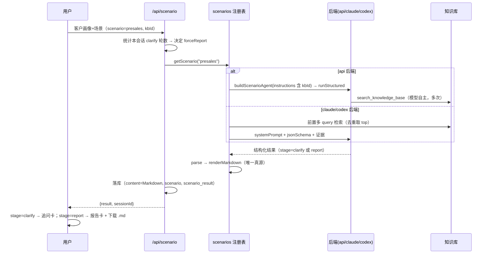

# 售前方案模式：客户画像 + 场景 → 基于腾讯 ADP 的销售方案报告

> 状态：已确认（2026-09-29） | 日期：2026-09-29 | 作者：伊泽瑞尔 + AI (deepseek-flash)

## 1. 背景

知识库已具备 481 篇语料（ADP 官方文档 479 + 《ADP FDE 认证课程》笔记 2），但 agent 只会「答问题」与「诊断工单」，**没有产出型场景**。

本次新增第三个场景：用户给一份客户画像与场景描述，agent **先追问缺失信息、再基于知识库生成一份《基于腾讯云 ADP 平台的销售方案报告》**。

报告的形态不自行发明，而是严格遵循用户课程笔记中的方法论（part2 §3.4「客户方案共创助手」）：**对外沟通 6 段式**、**方案画布 8 字段**、**模式选型四信号**、**风险评审 8 维度 + 四列表**，以及硬约束「不编造数据、案例、效果数字与排期报价」。

## 2. 目标与非目标

### 目标

1. 网页新增第三种模式「售前方案」，与「普通问答」「工单诊断」并存（诊断完整保留，CLI 与机器人行为零变化）。
2. **先追问再出稿**：信息不足时输出结构化追问（≤4 问，覆盖课程规定的 4 个维度），用户回答后出完整报告；连续 2 轮追问后**服务端强制出稿**（缺失信息落第 6 段）。
3. 报告严格 6 段，第 3 段含模式选型说明与方案画布 8 字段表，第 5 段含风险四列表。
4. 报告必须附知识库引用，且**列出**引用条目（现有诊断卡只显示条数）。
5. 页内阅读 + **下载 .md**（内容与页面渲染完全一致）。
6. 借这次机会兑现 foundation 文档的承诺：把场景定义抽成注册表。

### 非目标

- 不做 PDF/Word 导出、不做机器人入口、不做 CLI 子命令。
- 不做报告流式逐字渲染（结构化输出，逐字渲染无意义）。
- 不做报告版本管理、编辑后再导出。
- **不生成报价与工期数字**（课程明确未给此数据且禁止编造）。

## 3. 方案比较与选型

| 决策点 | 备选 | 选择与理由 |
|---|---|---|
| 模式组织 | 在 21 处硬编码里加第三个分支 / 全量 M5 重构 / **薄注册表** | **薄注册表**：新增 `scenarios/`（LLM 侧定义）+ `shared/scenario.ts`（UI 侧常量），两个 `Record<ScenarioId, …>` 用 TS 穷尽性互相锁定。收益是消掉 4 处**既有**重复（提示词写两遍、诊断 Markdown 拼两遍、三个后端各一份 `diagnose()`、composer 4 处三元），且不必给三个后端再加一个场景专用方法。全量重构会碰 CLI 与机器人，超出本期范围 |
| 追问/出稿建模 | 两次不同的 schema / `oneOf` 判别联合 / **单 schema + 扁平 `stage` 字段** | 三个后端在 strict 模式（api 的 structured outputs、claude 的 `--json-schema`、codex 的 outputSchema）都要求「全部 required + additionalProperties:false」，`oneOf` 分支会破坏该约束。故所有字段恒常存在，用 `stage` 区分：`clarify` 时 `questions` 非空、6 段为空串；`report` 反之 |
| 追问轮数控制 | 靠提示词自觉 / **服务端确定性判定** | 服务端统计本会话已有的 `stage=clarify` 条数，≥2 或请求带 `forceReport` 时强制出稿。提示词不可靠，确定性判定才可控 |
| 报告存储 | 复用 `diagnosis` JSONB / **新增 `scenario` + `scenario_result` 列** | 复用会让 `ChatMessage.diagnosis` 的类型说谎。新增列 + **读取回退映射**（旧行仍映射为 `scenario:"diagnosis"`），旧会话刷新后诊断卡照常渲染 |
| 报告 Markdown 生成位置 | 前端拼 / **服务端 `renderMarkdown`** | 服务端是唯一真源：页面渲染与下载内容必然一致，不存在两个渲染器漂移 |
| 引用展示 | 沿用「只显示条数」/ **新增 `ReferenceList`** | 报告要能溯源；诊断卡也换用它但保留原文案（避免破坏既有 e2e 断言） |

## 4. 接口与数据模型

### 4.1 共享契约

```ts
// packages/shared/src/scenario.ts（新，纯常量无依赖，web 可安全 import）
export type ScenarioId = "chat" | "diagnosis" | "presales";
export type StructuredScenarioId = Exclude<ScenarioId, "chat">;
export interface ScenarioUiMeta { id: ScenarioId; label: string; requiresKnowledgeBase: boolean; /* 占位符/按钮文案… */ }
export const SCENARIO_UI: Record<ScenarioId, ScenarioUiMeta>;

// packages/shared/src/backend.ts
export type ChatMode = ScenarioId;                 // 保留别名，前端不必改
export interface AgentRunRequest { /* …原有… */ forceReport?: boolean }
export type ScenarioResult = DiagnosisResult | PreSalesResult;
export interface AgentBackend {
  inspect(): Promise<AgentBackendStatus>;
  streamChat(request: AgentRunRequest): AsyncIterable<ChatStreamEvent>;
  runScenario(scenario: StructuredScenarioId, request: AgentRunRequest): Promise<ScenarioResult>;
  /** @deprecated 等价于 runScenario("diagnosis", …)；保留以免改动 CLI 与机器人调用点。 */
  diagnose(request: AgentRunRequest): Promise<DiagnosisResult>;
  close(): Promise<void>;
}
```

```ts
// packages/shared/src/presales.ts（新）
export type PreSalesStage = "clarify" | "report";
export type PreSalesQuestionField = "industry" | "audience" | "problem" | "expectedOutput";
export interface PreSalesQuestion { id: string; field: PreSalesQuestionField; question: string; why: string }
export interface PreSalesResult {
  scenario: "presales";
  stage: PreSalesStage;
  summary: string;
  questions: PreSalesQuestion[];
  needUnderstanding: string;    // 一、客户需求理解
  industryOpportunity: string;  // 二、行业与场景机会
  recommendedSolution: string;  // 三、推荐智能体方案
  demoScope: string;            // 四、第一版 Demo 范围
  deliveryRisk: string;         // 五、交付风险与前置条件
  nextInfoNeeded: string;       // 六、下一步需要客户补充的信息
  confidence: number;
  references: DiagnosisReference[];
  createdAt: number;
}
/** 6 段顺序与标题的唯一真源：UI、导出、服务端校验共用。 */
export const PRESALES_SECTIONS: ReadonlyArray<readonly [keyof PreSalesResult, string]>;
```

### 4.2 场景注册表 `packages/agent-runtime/src/scenarios/`

```ts
export interface ScenarioDefinition {
  id: ScenarioId;
  label: string;
  requiresKnowledgeBase: boolean;
  instructions: string;       // api 路径：Agent.instructions
  systemPrompt: string;       // claude/codex 路径：--system-prompt
  outputSchema?: z.ZodTypeAny;
  jsonSchema?: Record<string, unknown>;
  retrieval?: { queries(input: string): string[]; task(input: string, opts: { forceReport?: boolean }): string };
  parse(raw: unknown, references: DiagnosisReference[], ctx: { forceReport?: boolean }): ScenarioResult;
  renderMarkdown(result: ScenarioResult): string;   // 报告 Markdown 唯一真源
}
export const SCENARIOS: Record<ScenarioId, ScenarioDefinition>;
export function getScenario(id: ScenarioId): ScenarioDefinition;
```

`instructions` 与 `systemPrompt` 由同一份正文派生（前者追加工具说明、后者追加 JSON 输出要求），消掉「提示词写两遍」。

### 4.3 数据模型变更（`packages/data/src/db.ts`）

沿用既有 `ALTER TABLE … ADD COLUMN IF NOT EXISTS` 升级路径：

```sql
ALTER TABLE chat_sessions ADD COLUMN IF NOT EXISTS scenario TEXT NOT NULL DEFAULT 'chat';
ALTER TABLE chat_messages ADD COLUMN IF NOT EXISTS scenario TEXT;
ALTER TABLE chat_messages ADD COLUMN IF NOT EXISTS scenario_result JSONB;
```

**读取回退**（`toMessage`）：`scenario ?? (diagnosis ? "diagnosis" : null)`；`scenario_result ?? (diagnosis ? {...diagnosis, scenario:"diagnosis"} : null)`。旧行因此照常渲染诊断卡。

### 4.4 HTTP

- `apps/web/src/lib/scenario-route.ts`（新）：承接 `/api/diagnose` 的全部既有规则（400 缺参 / 404 会话不存在 / 409 已有会话不能切后端 / 503 后端不可用），并新增追问轮数判定。
- `/api/scenario`（新）与 `/api/diagnose`（改成 6 行 shim，**响应体仍是 `{diagnosis, sessionId}`**，现有 e2e 与外部调用不受影响）。

## 5. 时序



## 6. 前端交互规格

### 6.1 线框

```
模式行（三选一，等宽）
┌─────────────────────────────────────────────────────────────┐
│ [ 普通问答 ] [ 工单诊断 ] [ 售前方案 ]                        │
├─────────────────────────────────────────────────────────────┤
│ 运行方式 [API ▾] → 模型 [GLM-4.6 ▾] → 知识库 [腾讯云 ADP ▾]   │
├─────────────────────────────────────────────────────────────┤
│ ┌───────────────────────────────────────────────────────┐   │
│ │ 粘贴客户画像与场景，Enter 生成方案        [ 生成方案 ] │   │
│ └───────────────────────────────────────────────────────┘   │
└─────────────────────────────────────────────────────────────┘
未选库：知识库首项「请选择」+ warning「售前方案需要先选择知识库。」+ 按钮禁用

追问卡（stage=clarify）
┌─ 售前方案 · 需要补充信息 ───────────────────────────────────┐
│  为了给出可落地的方案，请先确认以下 3 点：                    │
│  1  客户属于哪个行业或业务部门？                    [行业]   │
│     用于检索同行业可落地场景与口径                            │
│  2  目标用户是谁？                                   [用户]  │
│  3  期望输出是什么？                                 [输出]  │
│  [ 回答这些问题 ]   [ 信息够了，直接出方案 ]                  │
└─────────────────────────────────────────────────────────────┘

报告卡（stage=report）
┌─ 售前方案报告 ─────────────  引用 8 条 · 置信度 72% ────────┐
│  基于腾讯云 ADP 平台的销售方案报告                            │
│  客户场景：… · 生成于 09-29 18:40          [ ⬇ 下载 .md ]    │
├─────────────────────────────────────────────────────────────┤
│  目录  ①需求理解 ②行业机会 ③推荐方案 ④Demo ⑤风险 ⑥待补信息   │
├─────────────────────────────────────────────────────────────┤
│  ▾ 一、客户需求理解 …（Markdown 正文）                        │
│  ▾ 三、推荐智能体方案 …（四信号表 + 画布 8 字段表）            │
│  ▾ 五、交付风险与前置条件 …（四列表）                          │
├─────────────────────────────────────────────────────────────┤
│  参考资料  [1] 智能体应用及其四种模式.md   0.83               │
└─────────────────────────────────────────────────────────────┘
```

### 6.2 状态清单

| 状态 | 触发 | 界面 |
|---|---|---|
| empty | 无消息 | 空态 + 两个快捷入口（诊断一个工单 / 生成一份售前方案） |
| 待追问 | 收到 `stage=clarify` | 追问卡；两个按钮可用 |
| 报告中 | 提交后等待（非流式，可能 30–90s） | 复用 `streaming.statusText`：「正在检索知识库并生成方案报告」+ 已用时秒数；发送按钮变「停止」 |
| 报告完成 | 收到 `stage=report` | 报告卡 + 下载按钮 |
| error | 请求失败/中止 | 复用现有错误块 + 重试 |
| 知识库无命中 | `references.length === 0` | 报告照常渲染 + 低置信度 +「知识库没有找到相关依据」 |

### 6.3 交互矩阵

| # | 用户动作 | 系统反馈 | 边界 |
|---|---|---|---|
| 1 | 点「售前方案」 | 切模式；知识库首项变「请选择」 | 已有消息时弹确认并新建对话（沿用后端切换交互） |
| 2 | 未选库 | 「生成方案」禁用 + warning | 与诊断一致；按 Enter 不发送，保留输入 |
| 3 | 提交画像 | 用户气泡 + 「报告中」+ 已用时 | 乐观插入 |
| 4 | 收到 clarify | 追问卡；**不自动填**输入框 | 按 `field` 打标签 |
| 5 | 点「回答这些问题」 | 模板填入输入框并聚焦 | 用户可编辑 |
| 6 | 连续 2 轮 clarify 后再提交 | 服务端强制出稿 | 缺失信息落第 6 段 |
| 7 | 点「信息够了，直接出方案」 | 发 `forceReport:true` | 按钮期间禁用 |
| 8 | 报告中并发点击 / 停止 | 沿用现有 streaming/abort 机制 | — |
| 9 | 追问中途切回普通问答 | 允许，下一轮走 chat | stage 只看 presales 消息，不会丢 |
| 10 | 刷新页面 / 切回历史会话 | 从 `scenario` 恢复模式、从 `scenarioResult` 重建追问/报告卡 | 依赖新列与回退映射 |
| 11 | 读取旧会话（只有 `diagnosis` 列） | 诊断卡正常渲染 | 回退映射 |
| 12 | 点「下载 .md」 | 浏览器下载 | 内容 = `message.content`（服务端唯一真源） |

## 7. 影响面

- `packages/shared`：`backend.ts`（`ScenarioId`/`runScenario`/`forceReport`）、`presales.ts`（新）、`scenario.ts`（新）、`diagnosis.ts`（加判别字段 `scenario`）、`chat.ts`（`ChatMessage` 加 `scenario`/`scenarioResult`；**删除从未被读取的死字段 `ChatRequest.mode`**）。
- `packages/data`：`db.ts`（三列）、`chat.ts`（读写与回退映射）。
- `packages/agent-runtime`：新增 `scenarios/`；`agents.ts`（`buildScenarioAgent` + **注入 knowledgeBaseId，修掉 api 路径引用恒空**）、`run.ts`（`runStructured`，保留 `runDiagnosis` 别名）、`backends/prompts.ts`（注册表驱动 + 多 query 检索 + `extractJsonObject` 加固）、三个后端（`runScenario` + `diagnose` 委派）。
- `apps/web`：`lib/scenario-route.ts`、`app/api/scenario/route.ts`（新）、`app/api/diagnose/route.ts`（shim）、`components/{composer,chat-app,message-list}.tsx`、`components/{presales-card,reference-list}.tsx`（新）、`lib/{api,download}.ts`。
- **零改动**：`apps/cli/**`、`packages/bot-core/**`、`apps/web/src/lib/server.ts` 的机器人路径。

## 8. 验收标准

1. 三模式并存；`chat.spec.ts` 4 条**一条不改**全部通过。
2. 售前模式强制选库；未选库不可提交。
3. 信息不足时先出追问卡（≤4 问、带 4 维度标签），回答后能出稿；连续 2 轮追问后必出稿。
4. 报告严格 6 段；第 3 段含四信号选型说明与 8 字段画布表；第 5 段含四列风险表。
5. 报告列出引用条目（标题/分数/摘要）；三种后端真实库命中时 `references.length > 0`。
6. **报告正文不出现金额与工期数字**（Playwright 守卫用例）。
7. 「下载 .md」内容与页面一致，文件名符合 `售前方案-<摘要>-YYYYMMDD-HHmm.md`。
8. 刷新后模式与追问/报告卡正确恢复；旧会话不受影响。
9. `pnpm typecheck && pnpm lint && pnpm lint:deps` 全绿。

## 8.1 实现与验收记录（2026-09-30）

**已完成的改动**：`shared/{scenario,presales,backend,chat,diagnosis}.ts`、`data/{db,chat}.ts`、`agent-runtime/scenarios/**`（新增 6 文件）、`agent-runtime/{agents,run,backends/*}.ts`、`apps/web/{lib/scenario-route.ts,lib/api.ts,lib/download.ts,app/api/{scenario,diagnose}/route.ts,components/{composer,chat-app,message-list,presales-card,reference-list}.tsx}`、`e2e/presales.spec.ts`。

**真实链路验收**（claude-cli 后端 + 真实知识库，curl 与浏览器各跑一遍）：

| 项 | 结果 |
|---|---|
| 信息缺失 → 追问 | `stage=clarify`，4 个问题恰好对应课程 4 维度（industry/audience/problem/expectedOutput），置信度 0.2 |
| 信息完整 → 出稿 | `stage=report`、**10 条引用**、六段俱全（356–1529 字）、第三段含四信号判断表与画布 8 字段、第五段含四列风险表，耗时 51s |
| `forceReport` | 信息缺失也直接出稿，缺的信息落到第六段（430 字逐条列出） |
| 硬约束 | 报告正文**无任何金额与工期数字**（正则校验通过） |
| 三种后端诊断 | api 后端**引用 10 条**（修复前恒为 0）；claude-cli 5 条；codex-cli 本机不可用（网络） |
| Playwright | 6/6 通过：既有 `chat.spec.ts` 4 条**一条未改**、新增 `presales.spec.ts` 2 条（含下载内容与「不写报价工期」守卫） |

**实现期额外修掉的问题**：

1. **api 路径的三个既有缺陷**（此前从未真正跑通）：① `knowledgeBaseId` 未注入提示词 → 检索工具拿不到真实库 id、引用恒为 0；② 提示词未逐字列出字段名 → 模型漏输出 `summary`；③ GLM 的 JSON 模式要求 prompt 含 "json" 字样 → 直接 400。①②③ 全部修复，并**放弃 SDK 的结构化输出通道**（经 aisdk 桥接到 GLM 走不通且报错被脱敏），统一成「提示词要求 JSON + 自解析（含围栏剥离与花括号配平降级）」。
2. **Next.js 按路由分别打包 server 代码** → 同一个 `@fde/data` 在不同路由里是不同模块副本 → **两个 PGlite 实例指向同一数据目录 → WASM `Aborted()`**（新加的 `/api/scenario` 一访问就炸）。修法：把 PGlite 实例从模块级变量挪到 `globalThis`，全进程唯一。
3. **兼容既有契约**：客户端按场景选端点（诊断仍走 `/api/diagnose`），并对旧响应体（无 `scenario` 判别字段）做归一，既有 e2e 因而一条未改。

**运维注意**：智谱账号的**向量模型**额度已恢复（embedding 正常），但**聊天模型（glm-4.6）额度仍为空**——`api` 运行时后端会报 `余额不足或无可用资源包`（页面会显示该错误与「重试」）。用 `claude-cli`/`codex-cli` 后端不受影响。

## 9. 开放问题

1. 报告生成耗时 30–90 秒（非流式），若频繁超时再调 `FDE_BACKEND_TIMEOUT_MS`。
2. 追问上限暂定 2 轮；实际使用中若发现常常追问不到点子上，再调提示词或上限。
3. 多版报告对比、报告编辑后再导出，留待有实际需求时再排。
