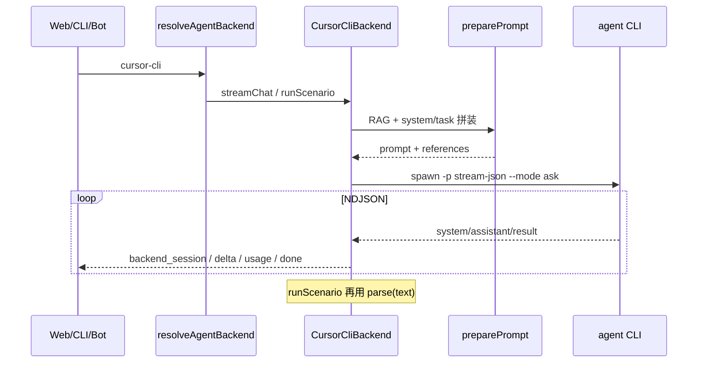

# Cursor CLI 后端接入与现状问题修复

> 状态：已实现（2026-09-30） | 日期：2026-09-30 | 作者：伊泽瑞尔 + AI (Composer)
>
> 确认结论：不透传 `--model`；强制 `--mode ask`；保留 gateway `cursor` 桩并修正 throw 文案。

## 1. 背景

前期 foundation 文档规划了 `cursor-cli`，model-gateway 也留了 `ProviderId "cursor"` / `FDE_CLI_CURSOR_BIN` 半截桩；但 2026-09-25 确认的后端兼容设计只落地了 `api` / `claude-cli` / `codex-cli`。结果是文档、CHANGELOG、gateway 与运行时三处不一致。

本次同时做两件事：① 把检查到的一致性问题修掉；② 按与 Claude/Codex 同级的方式接入 Cursor Agent CLI（二进制名官方为 `agent`）。

## 2. 现状检查结论（问题清单）

| # | 严重度 | 问题 | 建议 |
|---|---|---|---|
| 1 | 高 | `cursor-cli` 未实现，但 foundation / CHANGELOG / gateway 声称有 | 落地 `CursorCliBackend` 并统一文案 |
| 2 | 中 | `FDE_CLI_CURSOR_BIN` 命名与 `FDE_CLAUDE_BIN` / `FDE_CODEX_BIN` 不一致，且未进 `.env.example` | 统一为 `FDE_CURSOR_BIN`，兼容读旧名 |
| 3 | 中 | gateway `isProviderEnabled("cursor")` 依赖二进制，但 CATALOG 无 cursor 条目 → `fde models` 永远列不出 | Cursor **不走** model-gateway 模型表（与 claude/codex 一致：模型由 CLI 自身配置决定）；gateway 桩改为明确注释，去掉「配了 BIN 就算 enabled」的假路径，或保持 throw |
| 4 | 低 | `apps/cli/src/backends/` 空目录 | 删除空目录（实现归属在 `packages/agent-runtime`） |
| 5 | 低 | `apps/cli/src/config.ts` 手写 `claude-cli\|codex-cli` 判断，未复用 `isAgentBackendId` / `defaultAgentBackendId` | 改用 runtime 导出函数，避免再加后端时漏改 |
| 6 | 低 | `isAgentBackendId` 与 `backends` map 双份硬编码，易漂移 | 改为从 `Object.keys(backends)` 派生，或共享常量数组 |
| 7 | 低 | gateway 错误文案写「use @fde/cli backends」——包名不存在 | 改为 `@fde/agent-runtime` |
| 8 | 信息 | 本机 `cursor agent` 会尝试在线装 `cursor-agent`，当前环境未装上 `agent` 二进制 | 冒烟依赖本机安装；`inspect()` 对未安装返回清晰 detail |

非本次范围（已知可接受）：

- Claude/Codex 忽略 `-m`（文档已说明「api 后端」专用）
- Codex 每轮新起 app-server（无进程池）
- 本机未装 Cursor Agent 时无法做真实端到端冒烟（doctor/inspect 仍可验证）

## 3. 目标与非目标

### 目标

1. 新增后端 `cursor-cli`，与现有三者同级：Web / CLI / 机器人均可选。
2. 使用官方 Cursor Agent CLI 机器协议：`agent -p --output-format stream-json --stream-partial-output`。
3. 安全默认：`--mode ask`（只读问答，不改文件、不跑 shell）；cwd 固定 `tmpdir()`；不传 `--force`。
4. 宿主侧继续做 KB RAG（`preparePrompt`）；结构化场景靠提示词 + `extractJsonObject`（Cursor 无 `--json-schema`）。
5. 修复上表 #2–#7 的一致性问题。

### 非目标

- 不引入 `@cursor/sdk`（那是另一套编程面；本次对齐 Claude/Codex 的「spawn 本机 CLI」模式）。
- 不把 Cursor 模型塞进 `model-gateway` CATALOG（CLI 后端模型由 Cursor 登录态 / `--model` 决定；本期可不转发 `-m`，与 claude/codex 一致；若确认再可选透传 `request.model` → `--model`）。
- 不自动改写用户 Cursor 配置、不复制密钥。
- 不允许 Web/机器人经此后端写仓库或执行 shell。

## 4. 方案对比

| 方案 | 优点 | 问题 | 结论 |
|---|---|---|---|
| A. `@cursor/sdk` Agent.create | 类型好、流式 API 稳 | 新依赖、与现有 CLI spawn 架构不一致、需 API Key 路径 | 不选（可后续 ADR） |
| B. spawn `agent -p` + stream-json（对齐 claude） | 与现有后端同构、复用 preparePrompt/registry | 无原生 JSON Schema；ask 模式能力受限 | **采用** |
| C. 只做 CLI 入口包装、Web 不接 | 改动小 | 违背「三入口同后端」已确认架构 | 不选 |

## 5. 协议与适配

### 5.1 二进制解析

```
FDE_CURSOR_BIN  >  FDE_CLI_CURSOR_BIN（兼容旧名）  >  "agent"
```

安装提示：`curl https://cursor.com/install -fsS | bash`（官方文档）。本机 IDE 的 `cursor` 命令**不是** Agent CLI。

### 5.2 inspect

1. `runCommand(bin, ["--version"])` → installed
2. `runCommand(bin, ["status", "--format", "json"])` 或 `status`；若失败再看 `CURSOR_API_KEY` 是否存在 → configured / available
3. detail 写清：未安装 / 未登录 / 可用

### 5.3 streamChat / runScenario

Spawn 参数（拟定）：

```text
agent -p
  --output-format stream-json
  --stream-partial-output
  --mode ask
  --trust
  --workspace <tmpdir>
  [--resume <providerSessionId>]
  [--model <request.model>]   # 可选：默认不传，与 claude/codex 一致；开放问题见下
  <prompt>
```

系统提示：Cursor CLI 未见与 Claude 对等的 `--system-prompt`；把 `definition.systemPrompt` **拼进 user prompt 前缀**（与 prompts 层任务段并列），避免依赖未文档化 flag。

事件映射：

| Cursor NDJSON | → ChatStreamEvent |
|---|---|
| `system` + `subtype=init`（`session_id`, `model`） | `backend_session` |
| `assistant` 且有 `timestamp_ms`、无 `model_call_id` | `delta`（取 `message.content[].text`） |
| 其它 `assistant` | 忽略（防重复 flush） |
| `tool_call` | 忽略（ask 模式理论上极少；不转发 UI） |
| `result` success | `usage`（latency from `duration_ms`）+ 若未流过文本则补 `delta(result)` + `done` |
| 进程非 0 / stderr | `error` |

结构化场景：流结束后用现有 `definition.parse(text, references)`；无 `structured_output` 字段。

### 5.4 类型与注册

```ts
// packages/shared
export type AgentBackendId = "api" | "claude-cli" | "codex-cli" | "cursor-cli";
```

```ts
// packages/agent-runtime/backends
backends["cursor-cli"] = new CursorCliBackend();
// isAgentBackendId 从 Object.keys(backends) 派生
```

触及面：`apps/cli` 帮助文案、`config.ts`、Web composer 下拉（已由 `/api/backends` 动态列出，一般无需硬编码）、e2e mock 可补一条 cursor 状态、`.env.example`、`README`、runbook、CHANGELOG 措辞。

## 6. 时序



## 7. 影响面

| 路径 | 变更 |
|---|---|
| `packages/shared/src/backend.ts` | `AgentBackendId` 加 `cursor-cli` |
| `packages/agent-runtime/src/backends/cursor.ts` | **新增** |
| `packages/agent-runtime/src/backends/{registry,index}.ts` | 注册导出；`isAgentBackendId` 派生 |
| `packages/agent-runtime/src/backends/prompts.ts` | 注释改为含 cursor |
| `packages/model-gateway` | 修正错误文案；`isProviderEnabled("cursor")` 行为与注释对齐（建议恒 false / 或仅当显式策略，避免假 enabled） |
| `apps/cli` | 帮助文案、`config.ts` 用 `defaultAgentBackendId`；删空 `backends/` |
| `.env.example` / README / runbook | `FDE_CURSOR_BIN`、安装说明 |
| `apps/web/e2e` | mock 可选加第四后端（非必须） |

无数据模型 migration；已有 session 的 `backend` 枚举在应用层是字符串，旧数据不受影响。

## 8. 验收

1. `pnpm typecheck && pnpm lint` 全绿。
2. `pnpm dev:cli backend list` 出现 `cursor-cli`；未安装时 `available=false` 且 detail 可读。
3. 若本机已装并登录 `agent`：`pnpm dev:cli chat -b cursor-cli "你好"` 有流式输出；`diagnose` 能 parse JSON 并带 references。
4. `GET /api/backends` 含 cursor-cli 状态。
5. 上表 #2–#7 修复可在 diff 中核对。

## 9. 开放问题（需确认）

1. **`-m` / `request.model` 是否透传为 `--model`？** 建议默认不传（对齐 claude/codex）；若你希望 Web 模型下拉能驱动 Cursor，再开透传（仍不进 gateway CATALOG）。
2. **`--mode ask` 是否强制？** 建议强制（安全）。若需要 Cursor 读工作区文件再答，可改为默认 ask、用 env `FDE_CURSOR_MODE=ask|agent` 放开——但 agent 模式有工具风险，不建议给 Web/Bot 默认开。
3. **gateway 的 `ProviderId "cursor"` 桩**：保留并 throw（现状），还是直接删掉 cursor provider？建议**保留 throw + 修正文案**，避免有人误配 `cursor:xxx` 别名时行为诡异。
