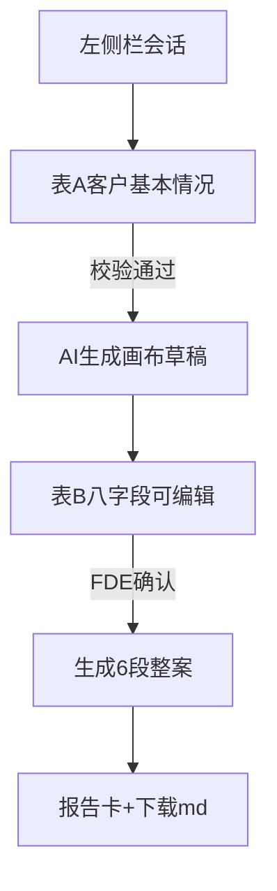

# 售前三步：受理表 → 画布确认 → 整案

> 状态：已实现（2026-09-30） | 日期：2026-09-30 | 作者：伊泽瑞尔 + AI (Composer)
>
> 确认口径：系统仅 FDE 使用；表 B = 课程方案画布 8 项且全部可改（含 ADP 模式）；客户名称必填；前端校验后关掉 clarify。

## 1. 背景

售前方案当前是「自由文本 + 模型追问（clarify）→ 6 段报告」。信息质量依赖模型猜缺什么，FDE 无法在出整案前审定方案画布。

本次改为 FDE 专用三步流水线，产物仍落在同一 `chat_sessions`（`scenario=presales`），左侧栏可追溯。

## 2. 目标与非目标

### 目标

1. 表 A（客户基本情况）真表单，前端必填校验。
2. 提交后 AI 只产出方案画布 8 字段草稿；FDE 全量可编辑确认。
3. 确认后生成既有 6 段整体方案；画布以 FDE 确认版为准。
4. 关掉 clarify / 追问卡；`stage` 变为 `canvas | report`。
5. 会话标题优先用客户名称。

### 非目标

- CLI / 机器人售前入口；客户自助填表；PDF/Word；报价工期字段；重做侧栏 IA。

## 3. 流程

## 4. 字段规格

### 表 A `PreSalesIntake`（全部必填，客户名称亦必填）

| key | 控件 | 校验 |
|---|---|---|
| customerName | 单行 | 非空 |
| industry | 单行 | 非空 ≥2 字 |
| audience | 多选枚举 + other 文案 | 至少一项枚举，或 other 非空 |
| problem | 多选枚举 + other 文案 | 同上 |
| expectedOutput | 单选枚举 + other 文案 | 必选；other 则文案必填 |
| sceneNarrative | 多行 | ≥10 字 |

枚举：

- audience: employee / cs / ops / sales / customer / manager / other
- problem: lowEfficiency / slowLookup / tooMuchManual / unstableProcess / poorUx / other
- expectedOutput: qa / workflow / doc / riskList / demo / other

### 表 B `PreSalesCanvas`（8 项）

statusQuo / businessGoal / entryPoint / adpMode / knowledgeAssets / processAndTools / inputOutput / boundaryAcceptance

## 5. 契约

- `PreSalesStage = "canvas" | "report"`；旧 `clarify` 消息只读降级展示。
- `AgentRunRequest.presalesPhase?: "canvas" | "report"`；售前默认由调用方传入。
- `PreSalesResult`：canvas 时 8 字段填满、6 段正文为空；report 时相反（canvas 字段可带回确认版快照便于回放）。
- 序列化：`serializePresalesIntake` / `serializePresalesBrief(A+B)` → Markdown 表喂模型。

## 6. 交互规格

| 状态 | 表现 |
|---|---|
| empty（新售前） | 主区/底部表 A；无自由文本主路径 |
| loading canvas | 按钮禁用 +「正在生成方案画布」 |
| canvas editing | 8 字段表单预填草稿；主按钮「确认并生成整体方案」；次「重新生成画布」 |
| loading report | 「正在生成整体方案」 |
| report | 既有 6 段卡 + 下载 md；无追问按钮 |
| error | 错误文案 + 可重试 |

边界：未选知识库不可提交；表 A 校验失败高亮；切换出售前模式仍确认新建会话。

## 7. 影响面

shared / agent-runtime scenarios/presales / scenario-route / web 表单与卡片 / e2e / CHANGELOG。

## 8. 验收

A→改画布一字→整案；侧栏回看 canvas+report；typecheck/lint；Playwright 覆盖表单主路径（可 mock API）。
